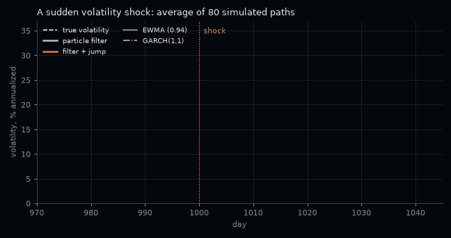
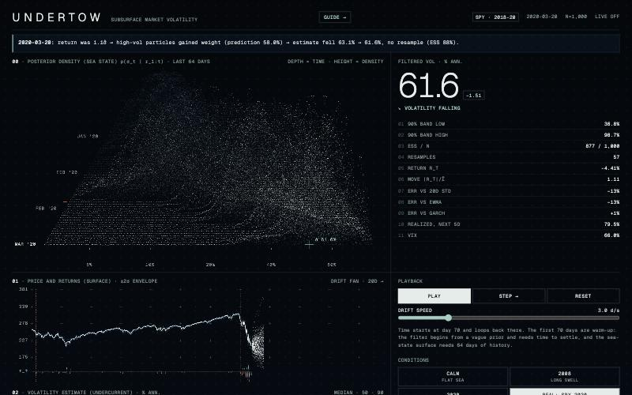
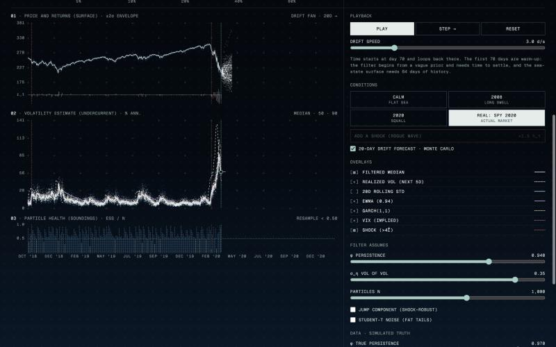
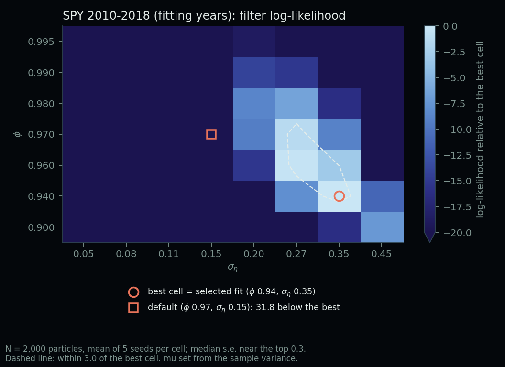
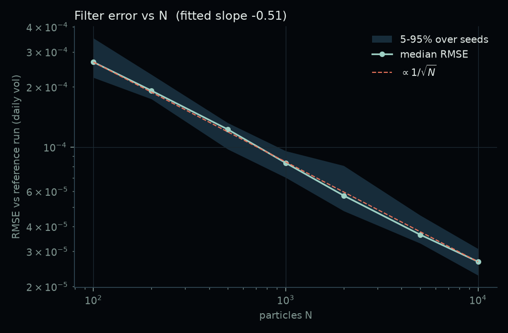
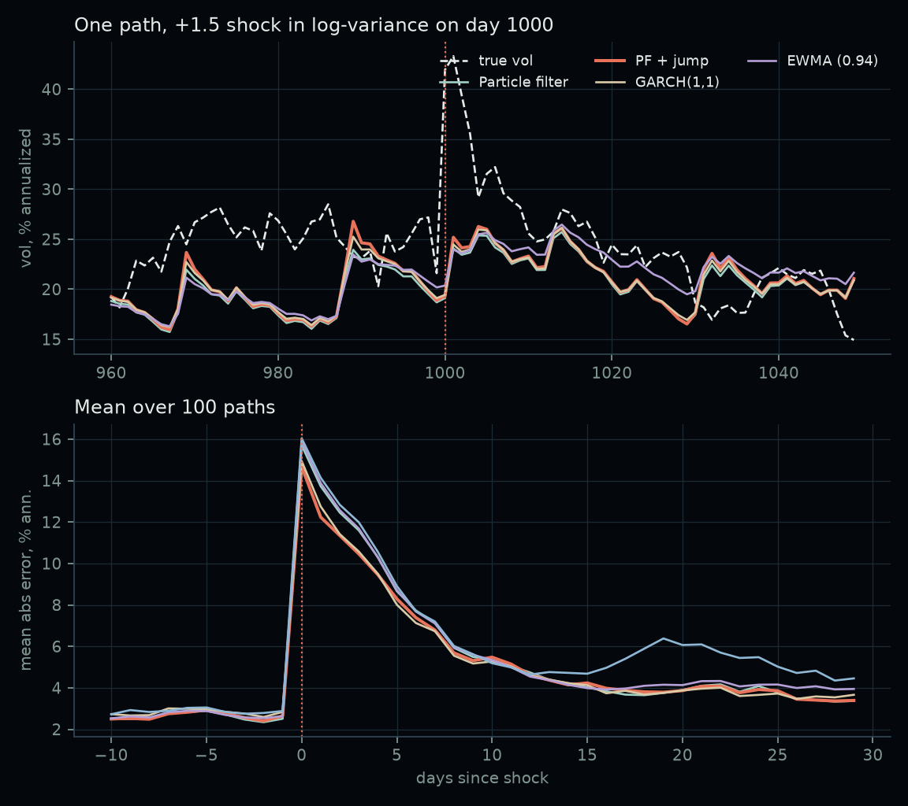
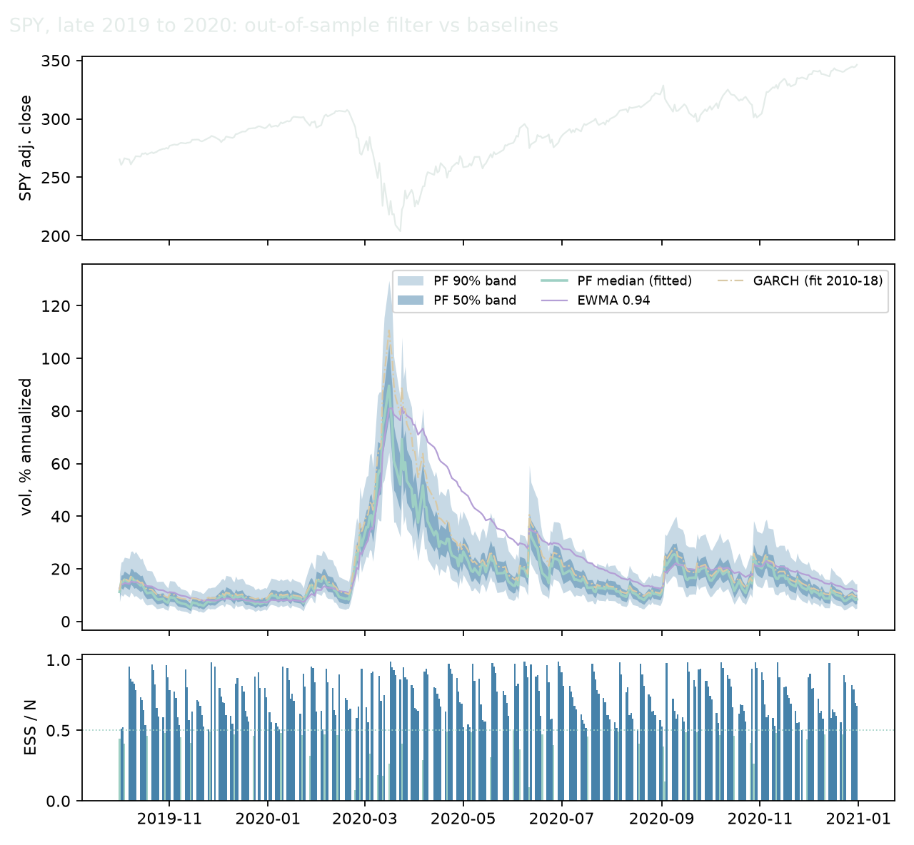
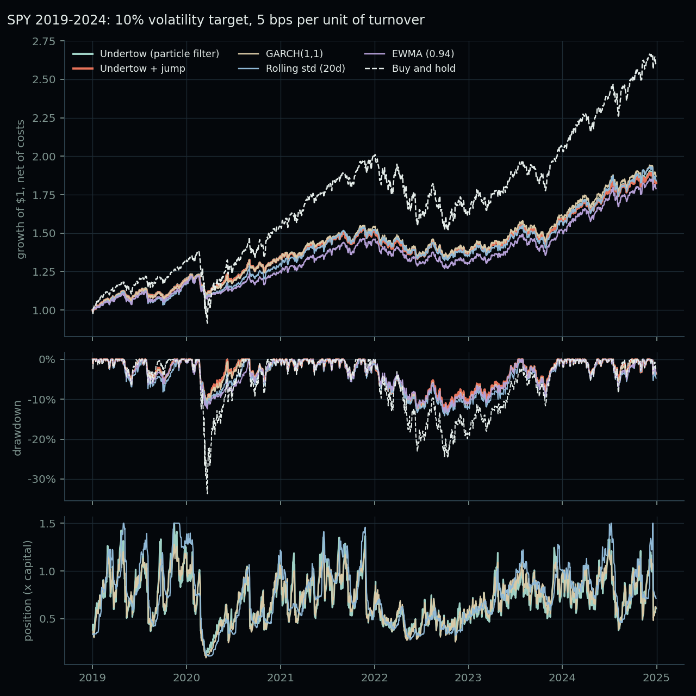

# Undertow

**TL;DR.** Undertow is a bootstrap particle filter that infers hidden volatility from daily returns,
with a live in-browser demo on simulated data and on real SPY returns. Fitted on 2010-2018 and tested
on 2019-2024, it is significantly more accurate than a 20-day rolling standard deviation
(Diebold-Mariano p = 0.003) and cannot be statistically distinguished from a GARCH(1,1) fitted on the
same years (p = 0.095, GARCH nominally ahead). Its main weakness, slow adaptation to a very large
sudden jump, is fixed by a jump component in the state equation: at a +1.5 shock the plain filter
trails GARCH by about 3 standard errors, and the jump variant closes the gap.

**Live demo:** https://sofiaksoder.github.io/undertow/ (deployed by `.github/workflows/pages.yml`).
To run it locally: `python3 -m http.server`, then open `/web/index.html`.
New to the topic? The in-site [guide](web/guide.html) explains what the demo shows,
how the filter works and how to use every control.

## Model

Stochastic volatility, daily returns:

    h_t = mu + phi * (h_{t-1} - mu) + sigma_eta * eta_t     eta_t ~ N(0, 1)
    r_t = exp(h_t / 2) * eps_t                              eps_t ~ N(0, 1)

`h_t` is the hidden log-variance. The filter weights particles by `N(r_t; 0, exp(h_t))` in log space,
resamples systematically when ESS < N/2, and reports the filtered mean, the 5/25/50/75/95% quantiles
of volatility, the ESS, and a log-likelihood estimate each day.

Two optional robust variants (off by default):
- **Jump:** each day, with probability `p`, `h` gets an extra `N(m, s^2)`. A sudden large rise in
  volatility becomes plausible under the prior instead of a many-sigma event.
- **Student-t:** the observation noise `eps_t` is Student-t (unit variance) instead of Gaussian.

## Estimating the parameters

The filter's log-likelihood estimate is used to fit `phi`, `sigma_eta` and `mu` on SPY, by grid search
(`scripts/fit_params.py`): a coarse grid on one seed, then the eight best cells re-scored with four more
seeds because the likelihood estimate is itself noisy. **Only 2010-2018 is used for fitting**
(2,263 days); 2019-2024 (1,509 days) is held out.

Fitted: **phi = 0.94, sigma_eta = 0.35, mu = -9.86**, against the hand-set defaults 0.97 and 0.15.
The fitted `sigma_eta` is more than twice the default, which matters: a +1.5 jump in log-variance is a
10-sigma event under 0.15 but about 4 sigma under 0.35.

| model | train log-lik (2010-18) | test log-lik (2019-24) |
|---|---:|---:|
| default (phi 0.97, sigma_eta 0.15) | 7720.8 | 4837.2 |
| **fitted** | 7752.6 | 4846.3 |
| fitted + jump (p 0.003, mean 1.5) | 7752.3 | **4847.2** |
| fitted + Student-t (dof 20) | **7754.5** | 4843.8 |
| fitted + jump + Student-t | 7753.6 | 4845.0 |

Fitting improves the held-out log-likelihood by 9.1. The robust variants add almost nothing on SPY
as a whole: the likelihood prefers a near-Gaussian t (dof 20) and a rare jump. A Bayesian treatment
such as PMMH (particle marginal Metropolis-Hastings), which would also give uncertainty on the
parameters, is the natural next step.

The figure shows the fitting years only (2010-2018; the held-out years are never used to choose
parameters). Each cell is the training log-likelihood averaged over 5 filter seeds with 2,000 particles,
relative to the best cell; the Monte Carlo standard error near the top is about 0.3
(`docs/results/loglik_surface.json` has every cell's mean and s.e.). The best cell is the selected fit
(`phi` 0.94, `sigma_eta` 0.35). The hand-set default sits 31.8 below it, far outside Monte Carlo noise, which
is why the SPY comparison uses the fitted values and reports the defaults only as a baseline. The dashed
line encloses the cells within 3.0 of the best: a ridge running from (0.94, 0.35) to (0.97, 0.27), so
`phi` and `sigma_eta` are only weakly separated, but nothing near `sigma_eta` = 0.15 is competitive.

That preference for a larger `sigma_eta` is a property of real SPY returns. The simulated shock
experiments below use the true simulated value (0.15) for every filter, so they are not affected by it.

## Results

All numbers are produced by the scripts in `scripts/` and stored in `docs/results/`.

### Monte Carlo error falls as 1/sqrt(N)

RMSE of the filtered mean vol against a 200,000-particle reference run on the same 500 simulated
days, 30 seeds per N (median and 5-95% range). Fitted log-log slope: **-0.51**.

| N | median RMSE (daily vol) | 5-95% over seeds |
|---:|---:|---:|
| 100 | 0.0266% | 0.0223-0.0351% |
| 1,000 | 0.0083% | 0.0070-0.0096% |
| 10,000 | 0.0027% | 0.0023-0.0031% |

### Response to a volatility shock (simulated, true volatility known)

Mean absolute error of daily vol in the 15 days from a shock added to log-variance, over 100 paths,
N = 2,000; units are 0.0001 of daily vol, lower is better. The filters use the **true** model
parameters (a best case). **GARCH is fitted only on the 950 days before the shock**, so it has no
in-sample advantage; the jump and Student-t settings come from the SPY fit, not from these shocks.

| shock | none | +0.5 | +1.0 | +1.5 |
|---|---:|---:|---:|---:|
| Particle filter | **16.0** | 21.4 | 33.8 | 51.4 |
| PF + jump | 16.7 | 21.6 | 33.3 | 48.5 |
| PF + Student-t | 16.3 | 21.3 | 33.9 | 52.7 |
| PF + jump + t | 16.8 | **21.1** | **32.5** | **48.4** |
| Rolling std (20d) | 17.2 | 22.7 | 35.4 | 52.6 |
| EWMA (0.94) | 16.1 | 21.7 | 34.4 | 51.5 |
| GARCH(1,1) | 17.8 | 21.8 | 32.7 | **48.4** |

Paired comparisons across the 100 paths (standard errors in brackets):
- **The weakness was real.** At +1.5 the plain filter trails GARCH by 3.0 (SE 0.9) and wins on only
  36 of 100 paths. At +1.0 it trails by 1.1 (SE 0.6).
- **The jump component fixes it.** At +1.5 the jump variant is level with GARCH (+0.05, SE 0.87) and
  beats the plain filter by 3.0 (SE 1.3), on 72 of 100 paths.
- **It has a small price.** With no shock the jump variant is worse than the plain filter by 0.7
  (SE 0.2).
- **Student-t does not help here:** the shocks are changes in volatility, not fat-tailed noise. It
  is slightly worse at +1.5 (1.3 worse, SE 0.3).
- With no shock the plain filter beats GARCH by 1.8 (SE 0.5).

An earlier version of this experiment fitted GARCH on each full path including the shock and
showed GARCH ahead by more; fitting it only on pre-shock days is the fair comparison.

### SPY, out of sample (fit 2010-2018, test 2019-2024)

True volatility is unobservable on real data, so each method makes a next-day volatility forecast
and is scored on two proxies: QLIKE against the next day's squared return (lower is better), and MAE
against the realized volatility of the next 5 days. Everything with parameters is fitted on 2010-2018
only, including GARCH. N = 2,000, averaged over 5 seeds.

| method | QLIKE 2019-24 | MAE 2019-24 | QLIKE Feb-Jun 2020 | MAE Feb-Jun 2020 |
|---|---:|---:|---:|---:|
| Particle filter (default params) | -8.213 | 0.354% | -5.942 | 1.037% |
| Particle filter (fitted) | -8.230 | 0.349% | -6.189 | 0.960% |
| PF fitted + jump | -8.233 | 0.354% | -6.241 | 0.952% |
| PF fitted + Student-t | -8.232 | 0.351% | -6.195 | 0.960% |
| PF fitted + jump + t | -8.235 | 0.356% | -6.261 | **0.944%** |
| Rolling std (20d) | -8.141 | 0.396% | -6.118 | 1.370% |
| EWMA (0.94) | -8.192 | 0.399% | -6.008 | 1.465% |
| GARCH(1,1), fit 2010-18 | **-8.242** | **0.347%** | **-6.272** | 1.018% |

**Diebold-Mariano tests** on the QLIKE loss differences, 2019-2024 (1,504 days; Newey-West variance):

| fitted particle filter vs | mean QLIKE difference | z | p |
|---|---:|---:|---:|
| Rolling std (20d) | -0.090 | -2.93 | **0.003** |
| EWMA (0.94) | -0.038 | -1.85 | 0.064 |
| GARCH(1,1) | +0.012 | +1.67 | 0.095 |
| default-parameter filter | -0.017 | -0.89 | 0.375 |
| fitted + jump + t | +0.005 | +1.16 | 0.245 |

Reading it: the filter is **significantly better than the 20-day rolling standard deviation**,
borderline against EWMA, and **not distinguishable from GARCH** (GARCH is nominally ahead). Fitting
the parameters improves the held-out log-likelihood but not significantly the forecast loss, and the
robust variants do not help over the whole six years.

They do help in the crash. On the single window Feb-Jun 2020 (104 days; chosen in advance because the
shock experiments predicted it, but still a small sample), the jump variant beats the plain fitted
filter (QLIKE -0.052, p = 0.036) and jump + t more so (-0.072, p = 0.014); neither is distinguishable
from GARCH there (p = 0.49 for the jump variant).

### Volatility-targeting backtest (SPY, 2019-2024, after costs)

Does a better volatility forecast make a better strategy? Each strategy holds a long-only position in
SPY of `w = clip(10% / forecast, 0, 1.5)` (the rest in cash at 0%), so only the forecast differs. A
forecast made after day t sets the weight held on day t+1, and moving the weight costs 5 bps per unit of
turnover. Everything with parameters was fitted on 2010-2018, including GARCH. Sharpe uses a zero
risk-free rate. The filter rows are the mean over 5 seeds (the seed-to-seed Sharpe range is 1.027-1.031).

| strategy (net of 5 bps) | return | vol | Sharpe | max drawdown | turnover / yr | avg position |
|---|---:|---:|---:|---:|---:|---:|
| Undertow (particle filter) | 10.7% | 10.4% | 1.03 | -13.1% | 15.9x | 0.71 |
| Undertow + jump | 10.5% | 10.2% | 1.03 | **-12.9%** | 16.1x | 0.70 |
| GARCH(1,1), fit 2010-18 | 11.0% | 10.4% | **1.06** | -13.6% | 12.7x | 0.72 |
| Rolling std (20d) | 10.8% | 11.0% | 0.98 | -14.1% | 7.4x | 0.75 |
| EWMA (0.94) | 10.3% | 10.4% | 0.99 | -13.3% | **5.7x** | 0.71 |
| Buy and hold | 17.9% | 19.8% | 0.90 | -33.7% | 0.2x | 1.00 |

Net Sharpe as costs rise (turnover does not change, so the ordering moves with cost):

| strategy | 0 bps | 5 bps | 10 bps | 25 bps |
|---|---:|---:|---:|---:|
| Undertow (particle filter) | 1.11 | 1.03 | 0.95 | 0.72 |
| Undertow + jump | 1.11 | 1.03 | 0.95 | 0.72 |
| GARCH(1,1) | 1.12 | 1.06 | 1.00 | 0.81 |
| Rolling std (20d) | 1.01 | 0.98 | 0.95 | 0.85 |
| EWMA (0.94) | 1.02 | 0.99 | 0.96 | 0.88 |
| Buy and hold | 0.90 | 0.90 | 0.90 | 0.90 |

Reading it:

- **Targeting volatility helps, whichever forecast drives it.** Every strategy cuts the worst drawdown
  from -34% (March 2020) to about -13% (the 2022 selloff) and has a higher Sharpe than buy-and-hold,
  though not significantly (Undertow vs buy-and-hold: +0.13, interval -0.31 to +0.50). That comes from
  the scaling, not from Undertow.
- **The forecasts are not separable on Sharpe.** A paired block bootstrap (seed 0, 20-day blocks) puts
  the filter's Sharpe at +0.05 over rolling std (95% interval -0.12 to +0.21) and -0.03 against GARCH
  (-0.08 to +0.03). Six years of one asset cannot rank these.
- **Undertow trades more than the others.** At 5 bps GARCH is nominally ahead, and the filter's turnover
  is more than double rolling std's, so at 10 bps its Sharpe has fallen to rolling std's and at 25 bps
  below it. This is not Monte Carlo noise: the same filter with 20,000 particles has the identical
  turnover. It is the fitted `sigma_eta = 0.35`, which makes the filter respond sharply to each return.
  Rerunning the filter with `sigma_eta = 0.15` cut turnover to 6.5x and gave Sharpe 1.05, but that was
  chosen after seeing the test years and is a diagnostic, not a result.
- **The jump variant helps nothing here.** Its crash drawdown is close to the others (-11.2% vs -10.7%
  to -12.4% over Feb-Jun 2020).

### Browser filter matches the Python filter

The demo's JavaScript filter and `pfvol` agree within Monte Carlo error on the same input
(`tests/data/parity.json`, reference: Python with 100,000 particles), for the plain filter and both
robust variants. RMS relative error of the filtered mean, averaged over 6 JS seeds:

| variant | N = 1,000 | N = 5,000 | log-lik, JS vs Python |
|---|---:|---:|---|
| plain | 0.94% | 0.41% | 790.90 vs 790.94 |
| jump | 1.08% | 0.46% | 790.53 vs 790.59 |
| Student-t | 0.90% | 0.38% | 791.59 vs 791.59 |

Reproduce by serving the repo root and opening `/tests/parity.html`.

## Demo

`web/index.html` is a single file (vanilla JS and canvas, no build step). It runs the filter live in
the browser on **simulated returns** (the page generates them from the model, so the true volatility
is known) or on **real SPY returns** (October 2018 to December 2020, `web/data/spy.json`, exported by
`scripts/export_web_data.py`).

- Panels lead with the plain term and keep the metaphor as a subtitle, e.g. "02 Volatility estimate
  (undercurrent)". A one-line **caption** narrates each day: the return in units of sigma-hat, which
  way the weights moved, what the estimate did and whether the particles were resampled.
- **Baselines in the comparison panel:** 20-day rolling std, EWMA and GARCH(1,1), plus the VIX on real
  data. GARCH uses parameters fitted offline (on SPY 2010-2018 for real data).
- **Presets:** Calm, 2008, 2020 (simulated shocks) and **Real: SPY 2020**. The real preset's filter
  uses the fitted parameters, so 2019-2020 is out of sample. With no true volatility, the reference
  line is the realized volatility of the next 5 days (hindsight).
- **Filter assumes** (phi, sigma_eta, N, jump component, Student-t) is separate from **data truth**
  (true phi and sigma_eta of the simulated market), so misspecification can be created in either
  direction.
- Time starts at day 70 and loops there; the first 70 days are warm-up (the filter starts from a vague
  prior, and the surface needs 64 days of history). The demo opens on a title screen; Space plays or
  pauses and the right arrow steps one day. With `prefers-reduced-motion` it stays paused after Enter.

## Run it

    pip install -r requirements.txt && pip install -e .
    pytest                                    # unit tests
    python scripts/convergence.py             # -> docs/figures/convergence.png
    python scripts/fit_params.py              # -> docs/results/fit.json, loglik_surface.json and its figure (needs network the first time)
    python scripts/spy_run.py                 # out-of-sample SPY evaluation + Diebold-Mariano
    python scripts/backtest.py                # -> docs/results/backtest.json, docs/figures/backtest.png (about a minute)
    python scripts/shock_response.py          # -> docs/figures/shock_response.png (a few minutes, 8 cores)
    python scripts/make_gif.py                # -> docs/figures/shock_response.gif
    python scripts/export_web_data.py         # -> web/data/spy.json
    python scripts/make_parity_fixture.py     # -> tests/data/parity.json

Layout: `pfvol/` (model, filter, baselines, data, metrics), `tests/`, `scripts/`, `docs/`, `web/`.

## Limitations

- **Gaussian innovations in the base model:** real returns have fatter tails. The Student-t option
  addresses this, but the fit prefers it only weakly on SPY.
- **No leverage effect** (return shocks and volatility shocks are independent).
- **Parameters are estimated once** on 2010-2018 and then held fixed; there is no re-estimation and no
  uncertainty on them (a PMMH treatment would add that). The grid search is coarse.
- **The jump variant's settings are not identified by SPY:** the likelihood is flat across rare-jump
  settings, so the jump probability and size are a modelling choice, not an estimate.
- **Shock experiments use the true model parameters** for the filters, a best case; real use would
  also have estimation error.
- **Real-data scoring is proxy-based** (noisy realized-volatility proxies); the Diebold-Mariano
  tests account for noise in the loss differences, but the Feb-Jun 2020 window is only 104 days.
- **The demo's baselines are fixed:** EWMA uses 0.94 and GARCH uses offline-fitted parameters, so
  neither follows the sliders. The realized-volatility line on real data uses future days.
- **The backtest is one asset and six years,** with a flat per-turnover cost (no spread model, market
  impact, financing or taxes), daily rebalancing, a 0% cash return and a Sharpe with a zero risk-free
  rate. Position sizes are not rounded to tradable lots. Differences between the forecasts are well
  inside the bootstrap interval.
- GARCH sometimes reported optimizer convergence warnings on simulated paths; results were kept.
